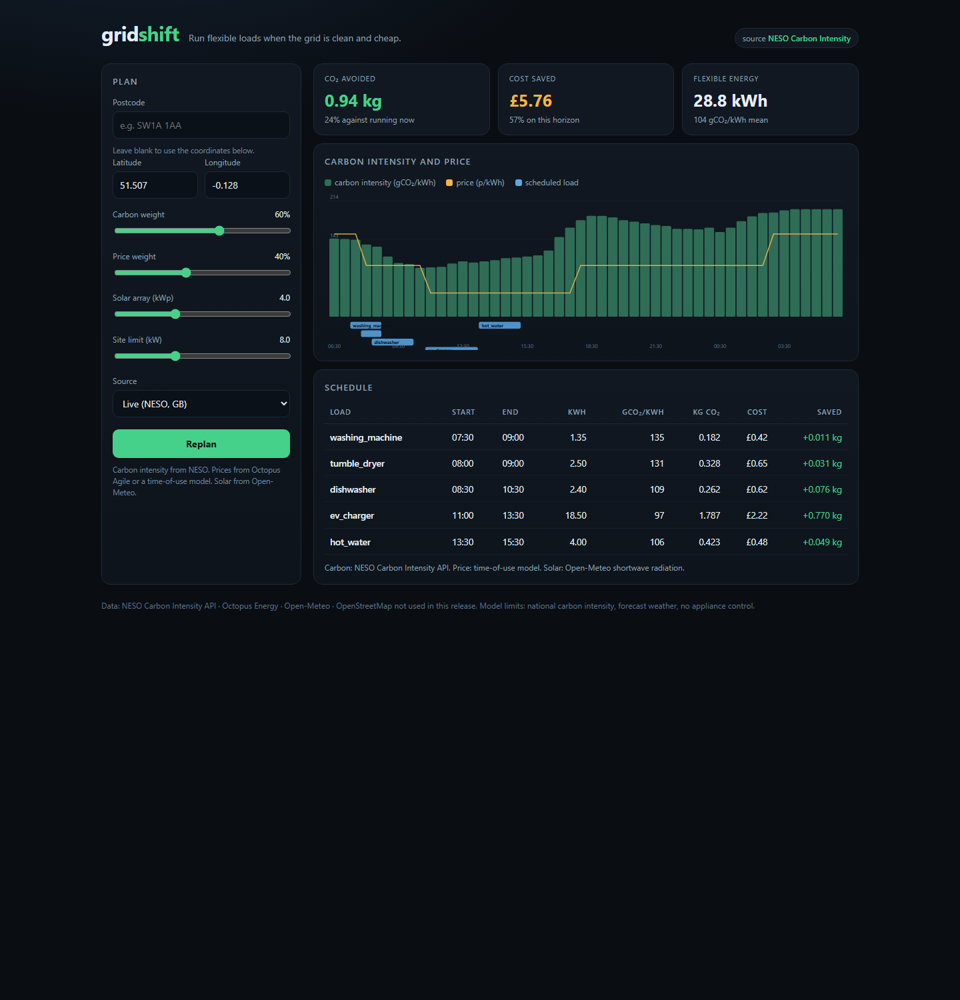
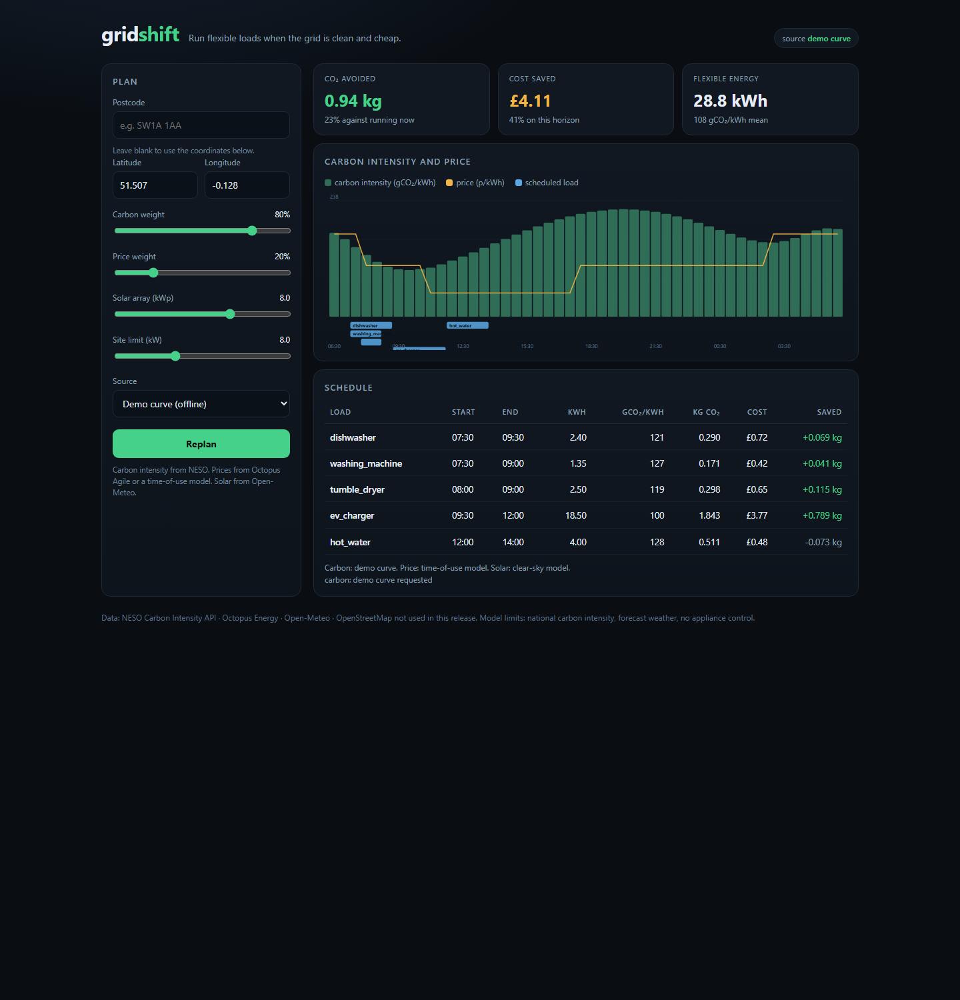

# gridshift

Plan flexible home loads when the grid is cleanest and cheapest.

[](LICENSE)
[](https://www.python.org/)
[](tests)

gridshift reads the next 24 hours of grid carbon intensity and electricity price. It puts each flexible load in the best 30-minute slot. It then shows the carbon and cost saving against a "run it now" baseline.

A dishwasher does not care when it runs. The grid does.

## Features

- **One objective, two signals.** Blend carbon intensity and price with a weight you set.
- **Five default loads.** Dishwasher, washing machine, tumble dryer, hot water and EV charger.
- **Live public data.** NESO carbon intensity, Octopus Agile prices and an Open-Meteo solar forecast.
- **Offline demo.** A deterministic curve runs with no network and no key.
- **Three outputs.** A CLI table, JSON for scripts, and a local web UI.
- **Home Assistant ready.** Publish the plan over MQTT with one command.
- **Safe by design.** A site load limit applies to each slot. The solver is deterministic and the tests run offline.

## Quick start

```bash
git clone https://github.com/fuleinist/gridshift
cd gridshift
python -m venv .venv
```

Windows:

```powershell
.venv\Scripts\activate
```

Linux and macOS:

```bash
source .venv/bin/activate
```

Install and run:

```bash
pip install -e ".[dev]"
python -m gridshift plan --postcode "SW1A 1AA" --solar-kwp 4
python -m gridshift serve --port 8011
```

Open <http://127.0.0.1:8011> for the web UI.

Run the tests:

```bash
python -m pytest
```

Try the offline demo. It makes no network call:

```bash
python -m gridshift demo
```

## How it works

1. Build 48 slots of 30 minutes from the next half hour.
2. Read carbon intensity and price for each slot.
3. Normalise both series to the range 0 to 1.
4. Score each slot as `carbon_weight × carbon + price_weight × price`.
5. Place each load at its best feasible start, in priority order.
6. Improve the plan with coordinate descent until no load moves.
7. Build the baseline with the same loads at the earliest allowed start.
8. Report the difference between the plan and the baseline.

The baseline is what a household does without a plan. The saving is the value of the shift.

A load only pays for grid energy. Solar output covers other scheduled loads first. The rest covers the load under test. This rule keeps the solar model conservative.

### Example

```text
$ python -m gridshift plan --postcode "SW1A 1AA" --solar-kwp 4
Energy  28.8 kWh
Carbon  2.98 kg CO2e
Cost    £4.40
Saving  0.94 kg (24%) · £5.76 (57%)
```

## CLI options

| Option | Default | Meaning |
|---|---|---|
| `--lat`, `--lon` | London | Site coordinates |
| `--postcode` | none | Resolve a UK postcode with postcodes.io |
| `--hours` | 24 | Horizon length, 2 to 48 hours |
| `--carbon-weight` | 0.6 | Weight of carbon in the objective |
| `--price-weight` | 0.4 | Weight of price in the objective |
| `--solar-kwp` | 0 | Solar array size |
| `--max-load-kw` | 8.0 | Site limit for each slot |
| `--source` | auto | `auto`, `neso` or `demo` |
| `--agile` | off | Use Octopus Agile public rates |
| `--json PATH` | none | Write the full result as JSON |
| `--no-ev` | off | Drop the EV charger from the load list |

## Web UI

The UI shows a carbon chart, a price line, a schedule strip and a savings panel. Move a slider and the plan redraws.

Links keep their settings. For example:

```text
http://127.0.0.1:8011/?solar_kwp=8&source=demo&carbon_weight=0.8&price_weight=0.2
```

## API

```http
GET /api/plan?lat=51.507&lon=-0.128&carbon_weight=0.6&price_weight=0.4&solar_kwp=4&max_load_kw=8&source=auto
```

The response holds `summary`, `placements`, `baseline`, `ranked`, `slots`, `notes` and `meta`. Each source name sits in `meta`.

```bash
curl "http://127.0.0.1:8011/api/plan?source=demo&hours=12" | jq .summary
```

## Home Assistant

Install the MQTT extra and publish the plan:

```bash
pip install -e ".[mqtt]"
python -m gridshift mqtt --host 192.168.1.10 --topic gridshift/plan
```

See [docs/home-assistant.md](docs/home-assistant.md) for sensor examples.

## Screenshots


*Live NESO data for London. Carbon weight 60 percent. Solar array 4 kWp.*


*Demo curve with an 8 kWp array and carbon weight 80 percent. The demo needs no network.*

## Data sources

- [NESO Carbon Intensity API](https://carbonintensity.org.uk/) — half-hourly carbon intensity for Great Britain. Free and keyless.
- [Octopus Energy API](https://developer.octopus.energy/docs/api/) — public Agile unit rates. No key is needed for standard rates.
- [Open-Meteo](https://open-meteo.com/) — hourly shortwave radiation for the solar forecast. Free and keyless.
- [postcodes.io](https://postcodes.io/) — UK postcode lookup. Free and keyless.

The first release does not use OpenStreetMap. The MVP needs no building footprint data.

## Limits

- The live carbon source covers Great Britain only. Other regions use the demo curve.
- Carbon intensity is national or regional. A single street can differ.
- Solar output is a forecast. Clouds move.
- Octopus Agile is one tariff. Other tariffs use the built-in time-of-use model.
- The tool advises. The user or Home Assistant starts each load.
- A plan can trade a little carbon for a large price cut. Set the weights to match your goal.

## License

MIT. See [LICENSE](LICENSE).